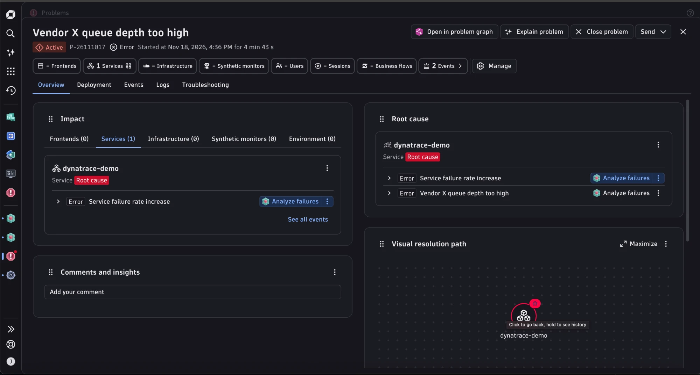
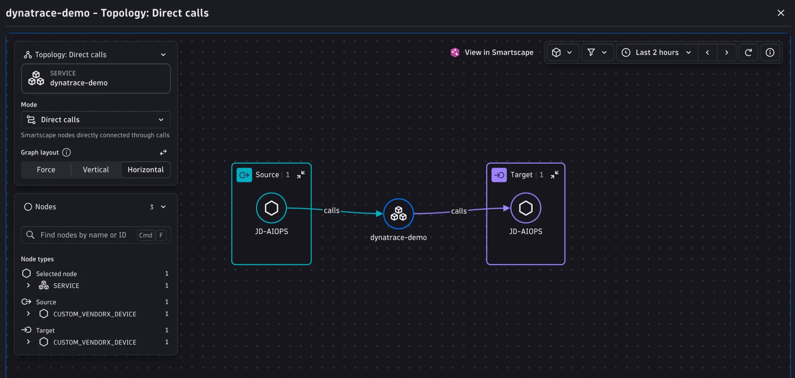

# dtaidemo: simulated 3rd-party telemetry for Dynatrace

Author: **Sam JD**

A small program that runs on a Linux VM and sends metrics to Dynatrace **every 30 seconds**.
Most of the time the values are normal. **Every 15–30 minutes it spikes for 5 minutes**, which gives you something to alert on.
You can also trigger a spike yourself at any time.

| Metric | Normal | During a spike |
|---|---|---|
| `dtaidemo.queue_depth` | ~25 | 250–400 |
| `dtaidemo.response_time_ms` | ~120 | 1,800–3,500 |
| `dtaidemo.error_rate_pct` | ~0.5 | 15–35 |
| `dtaidemo.throughput_rpm` | ~600 | 80–150 |

Every data point has the dimensions `source="dtaidemo"` and `host="<vm name>"`.
Part B shows two ways to tie the data to a Dynatrace service: in **OpenPipeline** (Way 1) or on the **VM only** (Way 2).

**Just want the checklist?** See **[Summary configuration](#summary-configuration)** at the end: everything to set on the
source, in OpenPipeline and in alerting, plus a screenshot of the end result.

> **You need a service to tie the metrics to.** Parts B and C attach the Vendor X metrics, alert and Smartscape node to an
> existing Dynatrace **service**. If you don't have one, deploy the companion app
> **[yahrghrr/dynatrace-demo](https://github.com/yahrghrr/dynatrace-demo)** as a separate application monitored by
> Dynatrace OneAgent. See [Don't have a service yet?](#dont-have-a-service-yet) below.

---

## Part A: Deploy it on your Azure VM

### A1. Create a Dynatrace API token (2 minutes)
1. In Dynatrace, open the **Access tokens** app (search "Access tokens" with Ctrl+K / Cmd+K).
2. Click **Generate new token**. Name it `dtaidemo`.
3. Add the scope **Ingest metrics** (`metrics.ingest`).
   - Optional: **Ingest logs** (`logs.ingest`), only needed for the log fallback in Part C.
   - Optional: **Write entities** (`entities.write`), only needed for the classic custom device in Part D.
4. Click **Generate** and **copy the token** (it starts with `dt0c01.`). You will only see it once.

You also need your **environment URL**. It's the address in your browser, e.g. `https://abc12345.apps.dynatrace.com`.
You can paste it as-is; the program converts it to the API address (`https://abc12345.live.dynatrace.com`) automatically.

### A2. Connect to the VM
In the **Azure portal**: open your VM, then **Connect**, and pick one of:
- **SSH using Azure CLI / Cloud Shell**, or
- **Bastion**, or
- the SSH command shown there, run from a terminal on your PC (e.g. `ssh azureuser@<public-ip>`).

You should now see a Linux prompt like `azureuser@myvm:~$`.

### A3. Install (copy & paste these 3 lines)
```bash
sudo apt-get update && sudo apt-get install -y git
git clone https://github.com/yahrghrr/dtaidemo.git
cd dtaidemo && sudo ./install.sh
```
(On RHEL/Alma/Rocky VMs use `sudo dnf install -y git` in the first line.)

The installer asks for:
1. the **URL**
2. the **token** (hidden while you paste it; that's expected)
3. **optionally**, the **service ID** (`SERVICE-…`) of the Dynatrace service this data belongs to. Press **Enter** to skip
   if you don't know it yet or want to use OpenPipeline instead; see **Part B** (this is "Way 2").

It then starts the service and shows the first few log lines. **`HTTP 202` means it's working.**

It runs in the background and **starts automatically after a reboot**. No outbound firewall changes are needed
on a standard Azure VM (outbound HTTPS is allowed by default).

### A4. Everyday commands
| What | Command |
|---|---|
| Watch it live (Ctrl+C to exit) | `sudo journalctl -u dtaidemo -f` |
| See the log for a past time window | `sudo journalctl -u dtaidemo --since "12:45" --until "13:55"` |
| **Force a spike now** (lasts 5 min) | `sudo dtaidemo-spike` |
| **Tie the data to a service** (or change it) | `sudo dtaidemo-set-service SERVICE-1A2B3C4D5E6F7A8B` |
| Untie it from the service | `sudo dtaidemo-set-service none` |
| Stop / start | `sudo systemctl stop dtaidemo` / `sudo systemctl start dtaidemo` |
| Change settings (interval, spike timing, …) | `sudo nano /etc/dtaidemo/config.env` then `sudo systemctl restart dtaidemo` |
| Update to the latest version (keeps your settings) | `cd ~/dtaidemo && git pull && sudo ./install.sh` |
| Remove everything | `cd ~/dtaidemo && sudo ./uninstall.sh` |

### A5. Check the data arrived in Dynatrace
Open a **Notebook**, add a DQL section and run:
```
timeseries v = avg(dtaidemo.queue_depth), by:{host, source}
```
You should see a line within 1–2 minutes.

**Troubleshooting:** `HTTP 401/403` means the token is wrong or missing the `metrics.ingest` scope.
To fix it, run `sudo rm /etc/dtaidemo/config.env && sudo ./install.sh` and enter the details again.

---

## Don't have a service yet?

Parts B and C need an existing Dynatrace **service** for the Vendor X metrics to belong to. If you don't have one, deploy
**[yahrghrr/dynatrace-demo](https://github.com/yahrghrr/dynatrace-demo)**. It's a small Spring Boot web app with a `/normal`
endpoint (HTTP 200) and an `/error` endpoint (HTTP 500), built to be monitored by Dynatrace OneAgent.

1. **Install OneAgent on the VM first.** In Dynatrace: **Deploy Dynatrace → Start installation → Linux**, then run the
   generated command on the VM. (It can be the same VM as dtaidemo or a different one.)
2. **Deploy the app:**
   ```bash
   git clone https://github.com/yahrghrr/dynatrace-demo.git
   ```
   ```bash
   cd dynatrace-demo && sudo bash setup.sh
   ```
   If OneAgent was installed *after* the app, restart the app so OneAgent can monitor it:
   `sudo systemctl restart dynatrace-demo`
3. **Send some traffic** so Dynatrace sees requests and creates the service:
   ```bash
   bash scripts/trigger.sh baseline 30
   ```
   (30 minutes of healthy traffic. Press Ctrl+C to stop early.)
4. After a few minutes, a service called **dynatrace-demo** appears in the **Services** app. Use **its** `SERVICE-…` ID in
   step B1.

Full instructions, including the firewall and troubleshooting, are in that repository's README.

**Bonus: test Vendor X and service problems together.** With both apps running, start `bash scripts/trigger.sh storm 10`
in the dynatrace-demo folder (10 minutes of ~50% errors), then about 3 minutes later run `sudo dtaidemo-spike`. If both
events are open at the same time, Dynatrace puts them on one problem card (tested). This needs the Vendor X alert to be on
the **service** with the event properties from **B5** (see also **C6**, option A). Step-by-step test and Notebook checks: **[Part E](#part-e-test-it-and-confirm-everything-in-a-notebook)**.

---

## Part B: Tie the data to your service (pick one of two ways)

Goal: every `dtaidemo.*` data point carries your service's ID (`SERVICE-…`), so Dynatrace can raise problems on that
service. There are two ways to do this. Pick one; the rest of the README tells you which field name to use for each.

| | **Way 1: OpenPipeline** | **Way 2: VM only** |
|---|---|---|
| Where the service ID is added | A processor in Dynatrace OpenPipeline | The dtaidemo program on the VM (`sudo dtaidemo-set-service`) |
| Best for | Showing the realistic setup: a real third-party tool usually can't change what it sends, so Dynatrace adds the ID | The quickest setup; the metrics also show under the service's **Metrics** tab |
| Field name to use in queries and alerts (B4, B5, B6) | `dtaidemo.service_id` | `dt.entity.service` |
| Field name for the Smartscape link (C4) | `dtaidemo.service_id` | `dt.smartscape.service` |
| OpenPipeline needed? | Yes (B2) | Not for alerting. For Part C, yes, but only the pipeline and route, no processor |

> **Why two different field names?** OpenPipeline isn't allowed to set Dynatrace's own `dt.entity.*` fields: trying
> `fieldsAdd dt.entity.service = …` gives *"It is not allowed to remove or modify field 'dt.entity.service'"*.
> So Way 1 uses our own field, `dtaidemo.service_id`. The program on the VM *is* allowed to send the real fields, so Way 2
> uses `dt.entity.service` (and `dt.smartscape.service` for Smartscape).
>
> Per Dynatrace's [OpenPipeline limits](https://docs.dynatrace.com/docs/platform/openpipeline/reference/limits), for
> metrics only `dt.entity.*` (plus `metric.key`, `metric.type`, `timestamp`, `value`, `dt.system.monitoring_source`) is
> blocked in the Processing stage. The Smartscape field **`dt.smartscape.service` is not blocked**, so on Way 1 you can
> optionally add it in the same processor:
> `fieldsAdd dtaidemo.service_id = "SERVICE-…", dt.smartscape.service = "SERVICE-…"`.
>
> **Doing both is fine.** Each record then carries both fields, and you can use either name.

### B1. Find your service's entity ID (both ways)
(No service yet? Deploy the demo app first: see [Don't have a service yet?](#dont-have-a-service-yet).)

Either open the service in Dynatrace and copy the `SERVICE-…` part of the browser URL, or run in a Notebook:
```
fetch dt.entity.service
| filter contains(entity.name, "my-service")
| fields id, entity.name
```

### B2. Way 1: add the service ID in OpenPipeline
**a) Create the pipeline**
1. Open the **OpenPipeline** app (Ctrl+K, then "OpenPipeline"). On older UIs it's under **Settings → Process and contextualize → OpenPipeline**.
2. Choose **Metrics**, open the **Pipelines** tab, and click **+ Pipeline**. Name it `dtaidemo`.
3. In the **Processing** stage click **+ Processor**, then **DQL**:
   - **Name:** `Attach service entity`
   - **Matching condition:** `source == "dtaidemo"`
   - **DQL processor definition:**
     ```
     fieldsAdd dtaidemo.service_id = "SERVICE-1A2B3C4D5E6F7A8B"
     ```
     **Replace `SERVICE-1A2B3C4D5E6F7A8B` with your real ID from B1.** The value in this README is only an example.
4. **Save** the pipeline.

**b) Route the data into the pipeline**
1. Still in **Metrics**, open the **Dynamic routing** tab and click **+ Dynamic route**.
   - **Name:** `dtaidemo`
   - **Matching condition:** `source == "dtaidemo"`
   - **Pipeline:** `dtaidemo`
2. Make sure the route sits **above** any catch-all route, then **Save**.

Then go to **B4**.

### B3. Way 2: add the service ID on the VM
1. **Running an older copy of dtaidemo?** (Installed before this option existed.) Update it first; your settings are kept:
   ```bash
   cd ~/dtaidemo && git pull && sudo ./install.sh
   ```
2. **Tie the data to the service**, using your real ID from B1:
   ```bash
   sudo dtaidemo-set-service SERVICE-1A2B3C4D5E6F7A8B
   ```
   (Run it without an ID and it asks for one. If you entered the ID during install, it's already done.)
   It saves the ID in `/etc/dtaidemo/config.env` as `SERVICE_ID=…`, restarts the program, and shows the log. Look for:
   ```
   Data is tied to service SERVICE-1A2B3C4D5E6F7A8B
   ```
   From now on, every data point carries `dt.entity.service` and `dt.smartscape.service` with that ID.
3. **Planning to do Part C?** Part C needs an OpenPipeline pipeline and route, just without the processor. Do **B2 a)**
   steps 1, 2 and 4 (skip step 3), then **B2 b)**. For alerting only (B4–B6), you can skip this.

To change the service later, run the same command with another ID. To untie: `sudo dtaidemo-set-service none`.

### B4. Verify (both ways)
After 1–2 minutes, run in a Notebook, using the field name for your way:

**Way 1:**
```
timeseries v = avg(dtaidemo.queue_depth), by:{dtaidemo.service_id}
```
**Way 2:**
```
timeseries v = avg(dtaidemo.queue_depth), by:{dt.entity.service}
```
The line should be labelled with your `SERVICE-…` ID (Way 2 may show the service's name). Only **new** data carries the ID,
not data that arrived before you set it up.

### B5. Alert on it (makes the problem card)

> **Final working alert at a glance** (tested: the Vendor X event and the service's own *Service failure rate increase*
> land on **one** problem card, with `dynatrace-demo` as the root cause). The steps below walk through each part.
>
> | Setting | Value |
> |---|---|
> | Query (Way 1) | `timeseries v = avg(dtaidemo.queue_depth), by:{dtaidemo.service_id}`<br>`\| fieldsRename dt.smartscape_source.id = dtaidemo.service_id` |
> | Query (Way 2) | the same with `dt.entity.service` in place of `dtaidemo.service_id` |
> | Condition | Static threshold, `150`, *Alert if metric is above* |
> | Title / Event name | `dtaidemo` / `Vendor X queue depth too high` |
> | Event property `dt.smartscape_source.id` | `{dt.smartscape_source.id}` |
> | Event property `dt.source_entity` | `{dt.smartscape_source.id}` |
> | Event property `event.type` | `ERROR_EVENT` |
> | Event property `dt.davis.is_merging_allowed` | `true` |

Open the **Anomaly Detection** app and click **+ Custom alert** (older UIs: **Custom anomaly detector**). Start in the **Simple** tab.

**1. Set scope, then Query.** Copy both lines for your way:

**Way 1:**
```
timeseries v = avg(dtaidemo.queue_depth), by:{dtaidemo.service_id}
| fieldsRename dt.smartscape_source.id = dtaidemo.service_id
```
**Way 2:**
```
timeseries v = avg(dtaidemo.queue_depth), by:{dt.entity.service}
| fieldsRename dt.smartscape_source.id = dt.entity.service
```
The second line matters. The alert links the problem to an entity through a dimension called **`dt.smartscape_source.id`**
(the hint under the query box says so), so we give our service ID that name.

**2. Define alert condition**
- Use case: **Static threshold**
- Threshold: `150`, Unit: leave as is
- Alert condition: **Alert if metric is above**
- Click **Preview**: you should see one line per service, with spikes above 150 if one has happened recently. Under
  **Result time series**, the `dt.smartscape_source.id` column must show your **`SERVICE-…`** (if it shows
  `CUSTOM_VENDORX_DEVICE-…`, the query is the node version from C6 option B).

**3. Add details**

In the **Simple** tab this step only has two boxes:
- **Title:** `dtaidemo`
- **Event name:** `Vendor X queue depth too high`
  (You can add ` on {dt.smartscape_source.id}` to put the service ID in the title.)

Simple fills in the link to the entity (`dt.smartscape_source.id`) and the event type for you, which is why the
`fieldsRename` line in the query matters.

**Then switch to the Advanced tab. This part is required for one shared problem card.** Simple mode alone produced
two separate cards in testing, for three reasons the properties below fix:
- **`CUSTOM_ALERT` events don't merge by default.** Dynatrace's
  [Davis event model](https://docs.dynatrace.com/docs/semantic-dictionary/model/davis) says merging is allowed by
  default *"except for the event type `CUSTOM_ALERT`, where it is by default not allowed"*. Simple mode creates
  `CUSTOM_ALERT` events, so every Vendor X event became its own problem
- Simple mode fills in only the new entity field (`dt.smartscape_source.id`). The classic field (`dt.source_entity`)
  stayed empty, and the problem's classic affected entity (`affected_entity_ids`) fell back to
  `ENVIRONMENT-0000000000000001`
- a `CUSTOM_ALERT` event is in a different category from the service's own *Error* problems

In the **Advanced** tab:
- **Event description:** plain text for whoever reads the problem, e.g.
  `Queue depth from the Vendor X feed is above 150 for service {dt.smartscape_source.id}.`
- **Event properties:** you need these four rows. Delete any others.

  | Key | Value | Why |
  |---|---|---|
  | `dt.smartscape_source.id` | `{dt.smartscape_source.id}` (pre-filled; keep it) | Ties the event to the service in the new Smartscape |
  | `dt.source_entity` | `{dt.smartscape_source.id}` (add this row) | Ties it to the service in the **classic** entity field too. Without it the problem's primary entity becomes `ENVIRONMENT-…` and it won't merge |
  | `event.type` | `ERROR_EVENT` | Same category (*Error*) as the service's own *Failure rate increase*, which helps merging. `CUSTOM_ALERT` also works for a standalone alert |
  | `dt.davis.is_merging_allowed` | `true` (add this row) | Allows one shared problem card |

  If a `dt.davis.is_merging_allowed` row is already there with `false`, change it to `true`. (With `ERROR_EVENT`, merging
  is allowed by default anyway; setting it explicitly makes it independent of the event type.)
  Dynatrace's docs mark `dt.source_entity` as **deprecated** (it refers to the classic entity storage; the replacement is
  `dt.smartscape_source.id`). It was still part of the working setup on a late-2026 tenant, so set both for now.

  Don't type the README's instructions into these boxes. `event.name` and `event.description` are filled from the fields
  above, so they don't need rows of their own.

Click **Save**.

> **Older tenants:** if your alert screen has no `dt.smartscape_source.id` hint or property, it uses the classic field instead.
> Leave out the `fieldsRename` line and add the property `dt.source_entity` = `{dims:dtaidemo.service_id}` (Way 1) or
> `{dims:dt.entity.service}` (Way 2).

Then run `sudo dtaidemo-spike` on the VM to test. A problem should open on the service within a few minutes.

### B6. Optional: show the Vendor X metrics on the service's page
There are two different things you might see on the service's page in the **Services** app:

**a) The alert, as a badge at the top** (next to *Failure rate*, *Response time*, *Throughput*). This works with **both ways**:
it appears for any alert attached to the service, like the B5 alert. Click the badge to see the alert's events.
If you move the alert to the Vendor X node (**C6** option B), the badge leaves the service.

**b) The metric charts themselves, under the service's Metrics tab.** This needs **Way 2**. The Services app lists a
metric there when it carries Dynatrace's own service fields, which only the VM can send. (On Way 1, you can do B3 as well;
the two ways work side by side.)
1. Wait a few minutes after B3.
2. On the service's page, click the **>** at the right end of the tab row and open **Metrics**.
3. Look for `dtaidemo.queue_depth` and the other `dtaidemo.*` metrics.

> **If the metrics don't show in the Metrics tab** (tenants differ), put them on a **dashboard** next to the service's charts
> instead: **Dashboards → + Tile**, and paste (use `dt.entity.service` on Way 2)
> ```
> timeseries queue_depth = avg(dtaidemo.queue_depth), by:{dtaidemo.service_id}
> ```

---

## Part C: Create a Smartscape node and link it to the service (OpenPipeline)

Part B only *tags* the metrics with the service ID. That makes problems land on the service, but it does **not** draw anything
new in Smartscape. To get a **node of its own, connected to your service**, you use the two Smartscape stages in your
OpenPipeline pipeline: **Smartscape node** creates the Vendor X node, and **Smartscape edge** connects the service to it.

**Which way the link points matters.** We model Vendor X as something the service **depends on**: the service *calls* Vendor X.
This is the direction Dynatrace follows when it looks for a root cause. When the service has problems, Dynatrace looks
**downstream** at what the service depends on, and if Vendor X has an open problem at the same time, Vendor X can be
reported as the root cause.

> **Before you start:** you need **Smartscape on Grail** and an OpenPipeline version that has the Smartscape stages
> (added in version 1.330). Field labels below match the pipeline editor as of late 2026; your tenant may differ slightly.

**What you'll end up with:**
```
 [ SERVICE: my-service ] ──(calls)──▶ [ CUSTOM_VENDORX_DEVICE: myvm ]
   the service depends on Vendor X        created from every dtaidemo data point
                                          (one node per VM, identified by "host")
```

### C1. Check which data type to use (metrics or logs)
1. Go to **Settings → Process and contextualize → OpenPipeline → Metrics** and open your `dtaidemo` pipeline from Part B.
   (**Way 2** and no pipeline yet? Create the pipeline and route as in **B2 a)** steps 1, 2 and 4, plus **B2 b)**. You
   don't need the processor.)
2. Look at the list of stages. Directly below **Processing** you should see **Smartscape node** and **Smartscape edge**.
   - **Yes (most tenants):** use this Metrics pipeline for the steps below.
   - **No:** use the **log fallback**. On the VM, edit the config (`sudo nano /etc/dtaidemo/config.env`) and set (or add)
     `HEARTBEAT_LOGS=true`, then `sudo systemctl restart dtaidemo`. The program now also sends one small log line
     per cycle with the same `source` and `host` fields. (The token needs **Ingest logs**; see A1.)
     Then in OpenPipeline, open **Logs** (not Metrics) and create a pipeline + route exactly like **B2 a) and b)**
     (same name, same matching condition `source == "dtaidemo"`; the DQL processor only on Way 1; on Way 2 the log lines
     already carry the service fields). Do steps C2–C5 in that **Logs** pipeline.

### C2. Check the service ID the link will point to
The link needs the ID that Smartscape on Grail uses for your service.
1. Open a **Notebook**, add a **DQL** section and run (put part of your service's name in the quotes):
   ```
   smartscapeNodes "SERVICE"
   | filter contains(name, "my-service")
   ```
2. Compare the ID shown with the `SERVICE-…` value from B1.
   - **Same (usual case):** nothing to do. The ID is already on every record: as `dtaidemo.service_id` (Way 1) or
     `dt.smartscape.service` (Way 2).
   - **Different:** add a field holding the ID from this step. In the **Processing** stage, edit **Attach service entity**
     (Way 1) or add a new **DQL** processor with matching condition `source == "dtaidemo"` (Way 2), with:
     ```
     fieldsAdd dtaidemo.service_smartscape_id = "<ID from this step>"
     ```
     On Way 1, keep the existing `dtaidemo.service_id = …` line too, separated by a comma.
     Then use `dtaidemo.service_smartscape_id` as the source ID field in C4.

### C3. Create the node, field by field (Smartscape node stage)
1. In the pipeline, click **+ Smartscape node** (or the **+** at the right of the **Smartscape node** row).
   A **New Processor** panel opens on the right.
2. **Name:** type `dtaidemo device node`.
3. **Matching condition:** it says `true` by default. Replace it with:
   ```
   source == "dtaidemo"
   ```
4. **Node type:** type `CUSTOM_VENDORX_DEVICE`.
   Per the [docs](https://docs.dynatrace.com/docs/platform/openpipeline/concepts/extraction/smartscape-extraction), it
   must be uppercase, start with `CUSTOM_` or `EXT_`, and be unique in your environment. This is the type name you'll
   see in Smartscape.
5. **Node ID field name:** type `dtaidemo.device_id`.
   This is *where Dynatrace writes the new node's ID* on each record. It's a new field name, not something that already
   exists. You use it again in C4 (the link) and C6 (alerts).
   > Dynatrace's default (and recommendation) for this box is `dt.smartscape.<type>`, here
   > `dt.smartscape.custom_vendorx_device`. Either name works; this README uses `dtaidemo.device_id` because that's what
   > the tested setup used. If you choose the default, use it everywhere this README says `dtaidemo.device_id`.
6. **ID components:** these decide what makes one node different from another. We want one node per VM:
   - in the left box (**ID component**) type `host`
   - in the right box (**Referenced field name**) type `host`
   - click **Add**. The list below should change from *No ID components defined* to show `host → host`.
7. **Extract node:** switch the toggle **on** (*"Generate a smartscape event based on this signal"*).
   Without this, the node is never actually created.
8. **Scroll down** in the panel. With **Extract node** on, these appear:
   - **Node name** (**required** when Extract node is on): choose **Field name** and enter `host`, so the node is labelled
     with the VM name (a **Static string** is the other option)
   - **Node validity duration** (optional): `60` minutes (allowed 60–1440; the program sends every 30 seconds, so the
     node stays alive)
   - **Recommended fields**: leave it as it is. Dynatrace copies those fields (e.g. `aws.region`) onto the node only when the
     data has them, and ours doesn't, so they're harmless.
   - **Static edges to extract**: **leave it empty.** A static edge can only point *from* this node *to* something else,
     which would make Vendor X depend on the service, the wrong way round. C4 adds the link in the other direction.
9. Click **Save** at the **top right** of the pipeline (blue button).

### C4. Make the service depend on Vendor X (Smartscape edge stage)
This link goes in the separate **Smartscape edge** stage, because it starts at the **service** and points **to** the Vendor X node.

> **Already added a static edge earlier?** (Older versions of this README linked Vendor X → service with **calls**.)
> Remove it first, or you'll have links in both directions: open **Smartscape node → dtaidemo device node**, scroll to
> **Static edges to extract**, delete the `calls → SERVICE` entry, and save.

1. In the pipeline, click **+ Smartscape edge** (or the **+** at the right of the **Smartscape edge** row).
2. **Name:** `dtaidemo service depends on vendor x`
3. **Matching condition:** replace `true` with
   ```
   source == "dtaidemo"
   ```
4. Fill in the **source** (the side the link starts from: the service):
   - **Source type:** `SERVICE`
   - **Source ID field name:**
     - **Way 1:** `dtaidemo.service_id`
     - **Way 2:** `dt.smartscape.service`
     - (or `dtaidemo.service_smartscape_id` if your IDs differed in C2)
5. **Edge type:** choose **calls**, meaning "the service calls Vendor X" (the service depends on it). In Dynatrace's
   [Smartscape model](https://docs.dynatrace.com/docs/semantic-dictionary/model/smartscape), `calls` is the standard
   relationship for *"services calling other services, but also services calling databases, queue brokers, or other
   infrastructure entities"*.
   If **calls** isn't offered, choose **uses**.
6. Fill in the **target** (the side the link points to: the Vendor X node):
   - **Target type:** `CUSTOM_VENDORX_DEVICE` (same as the node type in C3)
   - **Target ID field name:** `dtaidemo.device_id` (the node ID field from C3, step 5)
7. Click **Save** at the top right of the pipeline.

The node stage runs before the edge stage, so `dtaidemo.device_id` is already filled in when the edge is built.
When you're done, the pipeline should show **Processing 1**, **Smartscape node 1** and **Smartscape edge 1**.

> Exact labels in the edge panel may differ slightly (e.g. *Source node type* / *Target node type*). What matters is:
> **from** `SERVICE` using `dtaidemo.service_id` (Way 1) or `dt.smartscape.service` (Way 2), **to** `CUSTOM_VENDORX_DEVICE`
> using `dtaidemo.device_id`, type **calls**.

### C5. Check it worked (wait ~2–5 minutes)
1. **The node exists:** in a Notebook run
   ```
   smartscapeNodes "CUSTOM_VENDORX_DEVICE"
   ```
   You should see one row per VM running the program.
2. **The link exists and points the right way:** open **Smartscape**, find your service (e.g. `dynatrace-demo`) and open
   **View topology → Related nodes**. `CUSTOM_VENDORX_DEVICE` should now appear under **Target**, with the arrow going
   from the service to it labelled **calls**. If it appears under **Source** instead, the old static edge is still there
   (see the note at the start of C4). If it appears under **both** (as in the screenshot in
   [Summary configuration](#summary-configuration)), the old link is still inside the selected timeframe or still configured:
   see the note under that screenshot.
3. **Nothing appears?** Check that:
   - the processor shows no red warning icon in the pipeline
   - **Extract node** is on
   - the matching conditions say `source == "dtaidemo"`, not `true` or a typo
   - the field names are typed exactly: `dtaidemo.device_id`, and `dtaidemo.service_id` (Way 1) or
     `dt.smartscape.service` (Way 2)
   - Way 2: the program's log says `Data is tied to service SERVICE-…` (`sudo journalctl -u dtaidemo -n 20`)
   - in the edge: source = `SERVICE`, target = `CUSTOM_VENDORX_DEVICE` (not swapped)
   - the program is still sending (`sudo journalctl -u dtaidemo -f` shows `HTTP 202`)

### C6. Alerts and problems: where should the Vendor X alert live?
The Smartscape node and link (C3–C5) are for **seeing** the dependency. Where the Vendor X **alert** points decides what
problem cards you get. There are two choices:

| | **A. Alert on the service** (recommended, the B5 alert as is) | **B. Alert on the Vendor X node** |
|---|---|---|
| Vendor X spike + service errors at the same time | **One problem card** on the service, listing both events | **Two separate problem cards** (one on the Vendor X node, one on the service) |
| Vendor X spike alone | Problem on the service | Problem on the Vendor X node |
| Vendor X shown as a separate root-cause node | No (both events are on the service) | Only if Dynatrace's root-cause engine follows the custom link (see below) |

**Tested results** (late-2026 SaaS tenant):
- **Option B** produced **two separate problems**, even with both active at the same time and the service → Vendor X link in
  place. Dynatrace's root-cause analysis doesn't (yet) merge problems across links created in OpenPipeline.
- **Option A**, with the four event properties from **B5** (`dt.smartscape_source.id`, `dt.source_entity`,
  `event.type = ERROR_EVENT`, `dt.davis.is_merging_allowed = true`), produced **one problem** ("Vendor X queue depth too
  high", *2 Events*) with **dynatrace-demo** as the root cause, listing both *Service failure rate increase* and
  *Vendor X queue depth too high*.

So for a **single problem card**, use **option A** with those properties.

**Option A: alert on the service (one problem card)**
Keep (or put back) the B5 query for your way. Way 1:
```
timeseries v = avg(dtaidemo.queue_depth), by:{dtaidemo.service_id}
| fieldsRename dt.smartscape_source.id = dtaidemo.service_id
```
Way 2: the same with `dt.entity.service` in place of `dtaidemo.service_id`.
Plus the four event properties in the alert's **Advanced** tab (B5). Dynatrace then merges events on the **same entity**
that are open at the same time, so the Vendor X alert and the service's own error alert end up on one card.

**Option B: alert on the Vendor X node**
```
timeseries v = avg(dtaidemo.queue_depth), by:{dtaidemo.device_id}
| fieldsRename dt.smartscape_source.id = dtaidemo.device_id
```
Use this if you want the Vendor X node itself to turn red in Smartscape, and you're fine with a separate problem card.

> **Want both: one problem card *and* Vendor X marked on its node?** Use option A for the alert, plus a **copy** with the
> option B query whose **event type** is set to `CUSTOM_INFO` (alert's **Advanced** tab → **Event properties** →
> `event.type`). An info event shows on the Vendor X node's timeline but doesn't open a problem card of its own.

To test and confirm, follow **[Part E](#part-e-test-it-and-confirm-everything-in-a-notebook)**.

---

## Part D (alternative, classic): custom device via API

If your tenant doesn't have Smartscape on Grail or the Smartscape stages in OpenPipeline, you can still create a **classic custom
device** entity. It gets its own page with charts and problems, but it is **not linked** to the service in Smartscape.

1. Make sure your token has **`entities.write`** (see A1).
2. On the VM:
   ```bash
   cd ~/dtaidemo && ./create-custom-device.sh
   ```
   It prints an ID like `CUSTOM_DEVICE-ABCDEF0123456789`. Running it again updates the same device rather than creating a duplicate.
3. Attach that ID to the metrics. OpenPipeline can't set `dt.entity.*` fields, so do it on the VM: add this line to
   `/etc/dtaidemo/config.env` and run `sudo systemctl restart dtaidemo`:
   `EXTRA_DIMENSIONS=dt.entity.custom_device=CUSTOM_DEVICE-…`
   (To tie the data to the service as well, use `sudo dtaidemo-set-service SERVICE-…` (Way 2, B3); it works alongside
   `EXTRA_DIMENSIONS`.)
4. Find it in Dynatrace by searching for its display name. For problems on the device, use `{dims:dt.entity.custom_device}` as
   `dt.source_entity` in the detector.

---

## Part E: Test it and confirm everything in a Notebook

### E1. Run the combined test (service errors + Vendor X spike)
Both events must be **open at the same time** to share one problem card, so the order matters:
1. On the dynatrace-demo VM, in the `dynatrace-demo` folder, start the error storm (10 minutes of ~50% errors):
   ```bash
   bash scripts/trigger.sh storm 10
   ```
2. **About 3 minutes later**, on the dtaidemo VM, start a Vendor X spike (lasts 5 minutes):
   ```bash
   sudo dtaidemo-spike
   ```
3. Wait about 5 minutes, then run the queries below.

Both commands run **on the VMs** (in an SSH session from your laptop), not on the laptop itself.
If a spike has just ended, wait until `sudo journalctl -u dtaidemo -n 5` shows `[normal]` lines again before starting a new one.

### E2. Check queries (paste each into its own DQL section of a Notebook, timeframe e.g. last 6 hours)
Way 2 (VM only) users: use `dt.entity.service` wherever these say `dtaidemo.service_id`.

**1. Does the Vendor X data carry the service ID?**
```
timeseries v = avg(dtaidemo.queue_depth),
  by:{dtaidemo.service_id, dt.entity.service, dt.smartscape.service}
```
| You see | Meaning |
|---|---|
| Your `SERVICE-…` in every column you use | Correct |
| `dtaidemo.service_id` filled, the other two empty | You're on Way 1 only. That's fine |
| Two or more lines | The IDs disagree: check the B2 processor and `SERVICE_ID` on the VM |
| A straight line across a long gap | No data (or no data with the ID) arrived in that period: was the program stopped, the VM off, or the processor changed? Check with `sudo journalctl -u dtaidemo --since "12:45" --until "13:55"` (your times) |

**2. Which entity is each event attached to?**
```
fetch dt.davis.events, from: now() - 6h
| filter contains(event.name, "Vendor X") or contains(event.name, "error rate")
| fieldsAdd entity = coalesce(dt.smartscape_source.id, dt.source_entity)
| fields timestamp, event.name, event.status, entity, dt.davis.is_merging_allowed
| sort timestamp desc
```
- **Correct:** the newest **Vendor X** row and the **Request error rate increase** row show the **same `SERVICE-…`** in `entity`.
- Vendor X row shows **`CUSTOM_VENDORX_DEVICE-…`**: the alert still points at the Vendor X node. Fix it in the alert (E3).
- Vendor X row shows `dt.davis.is_merging_allowed` = **`false`**: merging is turned off in the alert. Add the property
  (see **B5**, Advanced tab). Empty or `true` is fine.
- Built-in events (like *Request error rate increase*) store the service in `dt.source_entity`, while the custom alert uses
  `dt.smartscape_source.id`. That's why the query combines both into `entity`, and why one of the two original columns is
  `null` for each event. That's normal.

**3. Did they land on one problem card?**
```
fetch dt.davis.problems, from: now() - 6h
| filter not(dt.davis.is_duplicate)
| filter contains(event.name, "Vendor X") or contains(event.name, "error rate")
| sort timestamp desc
| dedup display_id
| fields event.start, display_id, event.name, event.status, event.category, dt.davis.event_ids,
         smartscape.affected_entities, root_cause.smartscape_entity, affected_entity_ids
```
- **Merged:** one `P-…` row whose `dt.davis.event_ids` holds two or more IDs. In the **Problems** app it looks like this:
  one active problem, category *Error*, **2 Events**, **Root cause: dynatrace-demo (Service)**, listing
  *Service failure rate increase* and *Vendor X queue depth too high*. The problem's title comes from whichever event
  started first.
- **Not merged:** two `P-…` rows. Check, in this order:
  1. In query 2, the newest Vendor X row has `dt.davis.is_merging_allowed` = `false` → fix it in the alert (E3, step 4).
  2. In query 2, the newest Vendor X row shows `CUSTOM_VENDORX_DEVICE-…` → fix the query (E3, step 2).
  3. In query 3, the Vendor X problem's `affected_entity_ids` (classic, deprecated field) shows `ENVIRONMENT-…` instead of
     your `SERVICE-…`, even if `smartscape.affected_entities` and the Problems list show the service → add the
     `dt.source_entity` property (E3, step 4).
  4. In query 3, `event.category` differs (`CUSTOM_ALERT` vs `ERROR`) → set `event.type` to `ERROR_EVENT` (E3, step 4).
  5. Compare `event.start`: the two problems have to overlap in time.

  Older events from before a fix keep their old values, so only look at events created **after** you saved the change.
- To look at one problem, replace the `filter` line with `| filter display_id == "P-1234567"`.

> If a column is empty or a query errors, field names can differ slightly between tenants. Delete the `| fields …` line,
> run it again, and look for the field holding the `SERVICE-…` value.

### E3. Where to fix the alert if the checks show a problem
1. Open the **Anomaly Detection** app (Ctrl+K / Cmd+K, "Anomaly Detection") and open the **dtaidemo** alert.
   Make sure there's only one Vendor X alert, or that you're editing the right one.
2. On the **Simple** tab, expand **Set Scope** and set the **Query** to the B5 query for your way, e.g. Way 1:
   ```
   timeseries v = avg(dtaidemo.queue_depth), by:{dtaidemo.service_id}
   | fieldsRename dt.smartscape_source.id = dtaidemo.service_id
   ```
3. Click **Preview** (under **Define alert condition**). Under **Result time series**, the `dt.smartscape_source.id` column
   must show your `SERVICE-…`, not `CUSTOM_VENDORX_DEVICE-…`. **Simulated alerts** shows how many times the threshold
   would have fired.
4. Switch to the **Advanced** tab and, under **Event properties**, make sure these rows are there (add or change them):

   | Key | Value |
   |---|---|
   | `dt.smartscape_source.id` | `{dt.smartscape_source.id}` |
   | `dt.source_entity` | `{dt.smartscape_source.id}` |
   | `event.type` | `ERROR_EVENT` |
   | `dt.davis.is_merging_allowed` | `true` |
5. Click **Save**. The preview alone changes nothing. A Vendor X event that's already open stays where it is until it
   closes; only the **next** spike uses the new setting.

### E4. A note on Dynatrace Assist
Dynatrace Assist is useful for reading your event data (it found `dt.davis.is_merging_allowed = false` on the Vendor X
events), but check its fixes against this README:
- It may quote `dt.source_entity = {dims:dtaidemo.service_id}` as if it were part of your alert. That's usually leftover text
  in the alert's **Event description**, not a setting. Clean the description up in the alert's **Advanced** tab.
- It may suggest an "OpenPipeline Davis event processor" or hard-coding `dt.smartscape_source.id = SERVICE-…`. Neither is
  needed here: both settings belong in the **custom alert** (B5 / E3), and the `fieldsRename` line already fills in the
  service ID.
- It may report a mix of `SERVICE-…` and `CUSTOM_VENDORX_DEVICE-…` on past Vendor X events. That's just history from while
  the alert pointed at the Vendor X node (C6 option B); only events after your last change matter.

---

## Summary configuration

Everything that has to be configured, in one place, grouped by **where** it's configured. The steps above explain each item.

**End result** (tested): the Vendor X spike and the service's own failure-rate problem land on **one** problem card, with
the service as root cause:



**How the pieces connect:**
```
 SOURCE (VM)                    OPENPIPELINE (Metrics)                       ALERTING (Anomaly Detection)
 dtaidemo program  ──metrics──▶ route: source == "dtaidemo"                  custom alert on dtaidemo.queue_depth
 source="dtaidemo"              ├─ Processing: add dtaidemo.service_id       ├─ split by service ID → dt.smartscape_source.id
 host="<vm name>"               ├─ Smartscape node: CUSTOM_VENDORX_DEVICE    ├─ static threshold 150
 (+ SERVICE_ID on Way 2)        └─ Smartscape edge: SERVICE ─calls─▶ node    └─ event properties for merging
                                                                                       │
                                                                                       ▼
                                              ONE problem card on the service (with its own failure-rate event)
```

### 1. Source (the VM running dtaidemo)

| What | Value | README step |
|---|---|---|
| API token scopes | `metrics.ingest` (plus `logs.ingest` only for the log fallback) | A1 |
| Install | `git clone https://github.com/yahrghrr/dtaidemo.git && cd dtaidemo && sudo ./install.sh` | A3 |
| `DT_URL`, `DT_API_TOKEN` | your environment URL and token (asked by the installer) | A3 |
| Dimensions sent automatically | `source="dtaidemo"`, `host="<vm name>"` | (built in) |
| **Way 2 only:** service ID | `sudo dtaidemo-set-service SERVICE-…` → adds `dt.entity.service` and `dt.smartscape.service` | B3 |
| Test commands | `sudo dtaidemo-spike` (Vendor X spike); in dynatrace-demo: `bash scripts/trigger.sh storm 10` | E1 |

Settings live in `/etc/dtaidemo/config.env` (restart with `sudo systemctl restart dtaidemo` after editing).

### 2. OpenPipeline (Settings → Process and contextualize → OpenPipeline → **Metrics**)

| Where | Setting | Value | README step |
|---|---|---|---|
| **Dynamic routing** | Route | Name `dtaidemo`, matching condition `source == "dtaidemo"`, pipeline `dtaidemo`, placed above catch-all routes | B2 b) |
| **Pipeline `dtaidemo` → Processing** | DQL processor *Attach service entity* **(Way 1 only)** | Matching `source == "dtaidemo"`, definition `fieldsAdd dtaidemo.service_id = "SERVICE-…"` | B2 a) |
| **→ Smartscape node** | Processor *dtaidemo device node* | Matching `source == "dtaidemo"`; Node type `CUSTOM_VENDORX_DEVICE`; Node ID field name `dtaidemo.device_id`; ID component `host` → `host`; Extract node **on**; Static edges **empty** | C3 |
| **→ Smartscape edge** | Processor *dtaidemo service depends on vendor x* | Matching `source == "dtaidemo"`; Source type `SERVICE`, source ID field `dtaidemo.service_id` (Way 2: `dt.smartscape.service`); Edge type **calls**; Target type `CUSTOM_VENDORX_DEVICE`, target ID field `dtaidemo.device_id` | C4 |

**What the link looks like in Smartscape** (service → *Topology: Direct calls*):



- **Target** box: `dynatrace-demo` **calls** → `JD-AIOPS` (`CUSTOM_VENDORX_DEVICE`). This is the link from C4: the service
  depends on Vendor X. The node is named after the VM (`host`), here `JD-AIOPS`.
- **Source** box: `JD-AIOPS` **calls** → `dynatrace-demo`. This is the **old** link in the other direction (from an earlier
  version of this README, which used a static edge on the node). It shows up when:
  - the static edge is still in **Smartscape node → dtaidemo device node → Static edges to extract**: delete it and save, or
  - it was removed recently and is still inside the timeframe (here *Last 2 hours*). Switch to e.g. *Last 30 minutes*;
    once the old link is older than the timeframe (and the node validity), only the **Target** link remains.

Rules to remember:
- OpenPipeline **can't** set `dt.entity.*` fields. That's why Way 1 uses our own field, `dtaidemo.service_id`.
  It **can** set Smartscape fields such as `dt.smartscape.service` (only `dt.entity.*` is blocked for metrics).
- Node type must start with `CUSTOM_` or `EXT_`. The node ID field name defaults to `dt.smartscape.<type>`.
- A Smartscape edge needs **both** IDs already on the record: the node stage runs first and adds the node's ID.
- The Smartscape node and edge are for **seeing** the dependency (service → calls → Vendor X). They don't merge problems by
  themselves. Merging comes from the alert settings below.

### 3. Alerting (Anomaly Detection app → Custom alert)

| Tab / section | Setting | Value |
|---|---|---|
| Simple → **Set scope → Query** | Query (Way 1) | `timeseries v = avg(dtaidemo.queue_depth), by:{dtaidemo.service_id}`<br>`\| fieldsRename dt.smartscape_source.id = dtaidemo.service_id` |
| | Query (Way 2) | the same with `dt.entity.service` in place of `dtaidemo.service_id` |
| Simple → **Define alert condition** | Model | Static threshold, `150`, *Alert if metric is above* |
| | Preview check | `dt.smartscape_source.id` column shows `SERVICE-…` (not `CUSTOM_VENDORX_DEVICE-…`) |
| Simple → **Add details** | Title / Event name | `dtaidemo` / `Vendor X queue depth too high` |
| **Advanced → Event properties** | `dt.smartscape_source.id` | `{dt.smartscape_source.id}` |
| | `dt.source_entity` | `{dt.smartscape_source.id}` |
| | `event.type` | `ERROR_EVENT` |
| | `dt.davis.is_merging_allowed` | `true` |

### Rules for tying the problems together (what Dynatrace Assist found)
With only the query and threshold set, the Vendor X alert kept opening its **own** problem card. Dynatrace Assist, asked
why the problems weren't merging, read the event and problem data and found the blockers below. Each one had to be fixed;
the last row is the result once all of them were in place.

| # | Rule | What Dynatrace Assist found | Fix |
|---|---|---|---|
| 1 | The alert must be attached to the **service** through `dt.smartscape_source.id` | Vendor X events alternated between `CUSTOM_VENDORX_DEVICE-…` (alert pointed at the Vendor X node) and `SERVICE-…`. A device and a service are different entities, so Dynatrace had no shared entity to group them on | Query splits by the service ID and renames it: `\| fieldsRename dt.smartscape_source.id = dtaidemo.service_id`; event property `dt.smartscape_source.id` = `{dt.smartscape_source.id}` |
| 2 | Merging must be **allowed** on the event | `dt.davis.is_merging_allowed = false` on the Vendor X events. With this, Dynatrace never merges the event into another problem, whatever the entity or timing. Confirmed by the docs: merging is allowed by default *except for `CUSTOM_ALERT`* | Event property `dt.davis.is_merging_allowed` = `true` (and `event.type = ERROR_EVENT`, see row 4) |
| 3 | The classic **affected entity** must be the service too | The Smartscape affected entities showed the service, but the classic `affected_entity_ids` was `ENVIRONMENT-0000000000000001`, because the older `dt.source_entity` field was empty | Event property `dt.source_entity` = `{dt.smartscape_source.id}` (same service ID in the older field; deprecated per the docs, but part of the working setup) |
| 4 | Use a mergeable **event type** in the same category | Vendor X was `CUSTOM_ALERT`; the service's *Failure rate increase* was `ERROR`. `CUSTOM_ALERT` is the one type that doesn't merge by default | Event property `event.type` = `ERROR_EVENT` |
| 5 | Events must **overlap in time** | Starts 3 minutes apart: fine, not a blocker | Test order: start the error storm, then `sudo dtaidemo-spike` about 3 minutes later |
| ✅ | **Result** | One problem, *2 Events*, root cause **dynatrace-demo**, listing *Service failure rate increase* and *Vendor X queue depth too high* (screenshot above) | |

Also: put the alert on the **service**, not on the Vendor X node. An alert on the node gives a separate problem card (C6).
`dt.source_entity` is deprecated in favour of `dt.smartscape_source.id` (per the docs), but on this tenant the working
setup used both, so **set both**. All four properties were changed together, so the test doesn't show which one alone was
decisive; the docs point to the event type (`CUSTOM_ALERT` doesn't merge by default) as the main cause.

**Dynatrace Assist suggestions that weren't needed here:** an "OpenPipeline Davis event processor" (both settings belong
in the custom alert), and hard-coding `dt.smartscape_source.id = SERVICE-…` (the `fieldsRename` line already fills it in).
Its first answer also quoted `dt.source_entity = {dims:…}` from leftover text in the alert's description, which wasn't a
real setting. Use Assist to read the data, then check the fix against this table.

### 4. Check it worked
Run the three Notebook queries in **E2**:
1. the data carries the service ID
2. the Vendor X and failure-rate events show the same `SERVICE-…`, with merging allowed
3. one `P-…` problem with two event IDs

### Dynatrace documentation used
- [Smartscape node and edge extraction in OpenPipeline](https://docs.dynatrace.com/docs/platform/openpipeline/concepts/extraction/smartscape-extraction): node and edge processor fields, `CUSTOM_`/`EXT_` node types, `dt.smartscape.<type>` default field, node validity 60–1440 minutes
- [Define custom topology via OpenPipeline (tutorial)](https://docs.dynatrace.com/docs/platform/openpipeline/use-cases/tutorial-extract-topology)
- [Smartscape model](https://docs.dynatrace.com/docs/semantic-dictionary/model/smartscape): edge types such as `calls`, `belongs_to`, `runs_on`
- [OpenPipeline limits](https://docs.dynatrace.com/docs/platform/openpipeline/reference/limits): fields OpenPipeline can't modify (`dt.entity.*` for metrics)
- [Processing in OpenPipeline](https://docs.dynatrace.com/docs/platform/openpipeline/concepts/processing): stage order (Processing → Smartscape node → Smartscape edge → …)
- [Davis event and problem model](https://docs.dynatrace.com/docs/semantic-dictionary/model/davis): `dt.davis.is_merging_allowed` (not allowed by default for `CUSTOM_ALERT`), `dt.smartscape_source.id`, deprecated `dt.source_entity` / `affected_entity_ids`, event types

## Author

Created and maintained by **Sam JD**.
